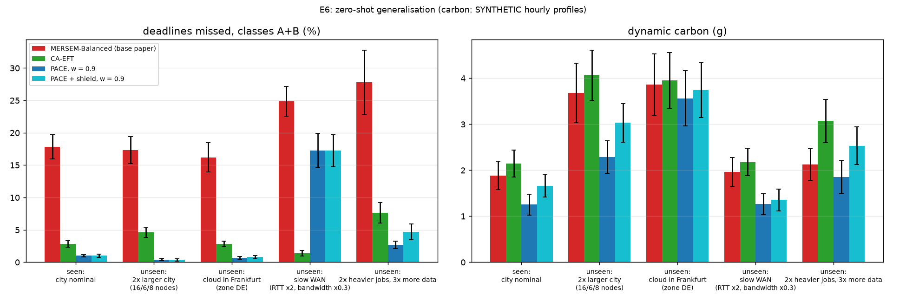

# E6: generalisation to unseen setups (simulation, 10 paired seeds)

> carbon: SYNTHETIC hourly profiles. PACE (`models/pace.pt`) was trained on city topologies with 2-6 edge, 1-3 fog and 1-3 cloud nodes, Mumbai + Stockholm only, WAN RTT x0.7-1.5 and bandwidth x0.5-1.5 around the defaults, and the dataset's train split. Every setup below except the first is outside that range; nothing was retrained. All runs use the held-out test split; each seed is a different day, workload and carbon trace shared by every method.

> **Change needed for the larger city:** the policy scores each node with a shared network, but the code had a fixed buffer of 12 candidate nodes (the training maximum). The buffer now grows with the topology; the weights are unchanged and results for 12 or fewer candidates are identical.

## seen: city nominal

| Method | alerts missed % | analytics missed % | A+B missed % | carbon dyn (g) | p95 alert (s) | work edge/fog/cloud % |
|---|---|---|---|---|---|---|
| MERSEM-Balanced (base paper) | 17.5 ± 1.9 | 52.5 ± 3.3 | **17.9 ± 1.9** | 1.9 ± 0.3 | 3.08 | 9/10/81 |
| MERSEM-SLA | 10.3 ± 2.6 | 37.0 ± 5.7 | **10.6 ± 2.6** | 6.2 ± 0.6 | 1.87 | 7/65/28 |
| EFT | 8.1 ± 2.0 | 0.3 ± 0.5 | **8.1 ± 2.0** | 5.1 ± 0.5 | 1.18 | 8/53/39 |
| CA-EFT | 2.8 ± 0.5 | 2.3 ± 2.4 | **2.8 ± 0.5** | 2.1 ± 0.3 | 0.79 | 6/15/79 |
| PACE, w = 0.9 | 0.9 ± 0.2 | 12.1 ± 3.8 | **1.0 ± 0.2** | 1.3 ± 0.2 | 0.80 | 6/5/89 |
| PACE + shield, w = 0.9 | 1.0 ± 0.2 | 3.7 ± 2.6 | **1.0 ± 0.3** | 1.7 ± 0.3 | 0.73 | 6/10/84 |
| PACE + shield, target 5% | 2.0 ± 0.4 | 12.2 ± 3.1 | **2.1 ± 0.4** | 1.2 ± 0.2 | 0.84 | 6/7/87 |

## unseen: 2x larger city (16/6/8 nodes)

| Method | alerts missed % | analytics missed % | A+B missed % | carbon dyn (g) | p95 alert (s) | work edge/fog/cloud % |
|---|---|---|---|---|---|---|
| MERSEM-Balanced (base paper) | 17.1 ± 2.1 | 47.4 ± 3.4 | **17.3 ± 2.1** | 3.7 ± 0.6 | 3.23 | 8/12/80 |
| MERSEM-SLA | 15.7 ± 2.3 | 34.5 ± 2.6 | **15.8 ± 2.2** | 11.7 ± 0.7 | 2.92 | 6/65/28 |
| EFT | 4.0 ± 0.8 | 0.0 ± 0.0 | **4.0 ± 0.8** | 9.5 ± 0.8 | 0.92 | 7/53/41 |
| CA-EFT | 4.7 ± 0.8 | 0.2 ± 0.5 | **4.6 ± 0.8** | 4.1 ± 0.5 | 0.95 | 6/14/80 |
| PACE, w = 0.9 | 0.4 ± 0.2 | 1.8 ± 1.4 | **0.4 ± 0.2** | 2.3 ± 0.4 | 0.73 | 6/4/90 |
| PACE + shield, w = 0.9 | 0.4 ± 0.2 | 0.6 ± 0.7 | **0.4 ± 0.2** | 3.0 ± 0.4 | 0.71 | 6/9/85 |
| PACE + shield, target 5% | 0.7 ± 0.3 | 2.3 ± 1.4 | **0.7 ± 0.3** | 2.1 ± 0.3 | 0.76 | 6/6/88 |

## unseen: cloud in Frankfurt (zone DE)

| Method | alerts missed % | analytics missed % | A+B missed % | carbon dyn (g) | p95 alert (s) | work edge/fog/cloud % |
|---|---|---|---|---|---|---|
| MERSEM-Balanced (base paper) | 15.8 ± 2.3 | 59.3 ± 3.9 | **16.2 ± 2.3** | 3.9 ± 0.7 | 2.75 | 8/11/80 |
| MERSEM-SLA | 10.3 ± 2.4 | 37.1 ± 5.9 | **10.5 ± 2.4** | 7.3 ± 0.8 | 1.87 | 7/66/26 |
| EFT | 8.0 ± 2.0 | 0.3 ± 0.5 | **7.9 ± 2.0** | 6.4 ± 0.8 | 1.17 | 8/53/40 |
| CA-EFT | 2.8 ± 0.4 | 2.2 ± 2.4 | **2.8 ± 0.5** | 4.0 ± 0.6 | 0.77 | 6/18/76 |
| PACE, w = 0.9 | 0.6 ± 0.2 | 8.8 ± 3.3 | **0.7 ± 0.2** | 3.6 ± 0.6 | 0.75 | 6/6/89 |
| PACE + shield, w = 0.9 | 0.8 ± 0.2 | 3.1 ± 2.6 | **0.8 ± 0.3** | 3.7 ± 0.6 | 0.71 | 6/10/84 |
| PACE + shield, target 5% | 1.6 ± 0.4 | 28.4 ± 5.6 | **1.9 ± 0.4** | 3.5 ± 0.6 | 0.85 | 6/7/87 |

## unseen: slow WAN (RTT x2, bandwidth x0.3)

| Method | alerts missed % | analytics missed % | A+B missed % | carbon dyn (g) | p95 alert (s) | work edge/fog/cloud % |
|---|---|---|---|---|---|---|
| MERSEM-Balanced (base paper) | 24.5 ± 2.3 | 56.1 ± 5.1 | **24.8 ± 2.3** | 2.0 ± 0.3 | 3.18 | 9/11/80 |
| MERSEM-SLA | 19.3 ± 5.0 | 38.3 ± 5.7 | **19.4 ± 5.0** | 6.5 ± 0.6 | 2.03 | 8/68/23 |
| EFT | 15.2 ± 3.0 | 0.7 ± 0.6 | **15.0 ± 2.9** | 5.2 ± 0.6 | 1.40 | 8/56/36 |
| CA-EFT | 1.4 ± 0.4 | 3.2 ± 2.4 | **1.4 ± 0.4** | 2.2 ± 0.3 | 0.90 | 6/16/78 |
| PACE, w = 0.9 | 17.3 ± 2.7 | 12.4 ± 3.6 | **17.3 ± 2.7** | 1.3 ± 0.2 | 1.07 | 6/5/89 |
| PACE + shield, w = 0.9 | 17.3 ± 2.5 | 5.9 ± 2.2 | **17.2 ± 2.5** | 1.4 ± 0.2 | 1.07 | 6/7/88 |
| PACE + shield, target 5% | 11.8 ± 3.7 | 8.4 ± 2.8 | **11.8 ± 3.7** | 1.6 ± 0.2 | 1.04 | 6/10/84 |

## unseen: 2x heavier jobs, 3x more data

| Method | alerts missed % | analytics missed % | A+B missed % | carbon dyn (g) | p95 alert (s) | work edge/fog/cloud % |
|---|---|---|---|---|---|---|
| MERSEM-Balanced (base paper) | 27.3 ± 5.0 | 76.8 ± 5.9 | **27.8 ± 5.0** | 2.1 ± 0.3 | 6.14 | 6/5/89 |
| MERSEM-SLA | 30.6 ± 6.8 | 45.0 ± 5.7 | **30.7 ± 6.7** | 8.9 ± 0.8 | 5.69 | 7/52/41 |
| EFT | 27.2 ± 6.5 | 3.1 ± 3.4 | **27.0 ± 6.4** | 8.1 ± 0.9 | 1.97 | 8/46/46 |
| CA-EFT | 7.6 ± 1.6 | 7.5 ± 4.0 | **7.6 ± 1.6** | 3.1 ± 0.5 | 1.21 | 4/13/83 |
| PACE, w = 0.9 | 2.4 ± 0.5 | 33.1 ± 5.7 | **2.7 ± 0.6** | 1.8 ± 0.4 | 0.84 | 3/6/91 |
| PACE + shield, w = 0.9 | 4.6 ± 1.2 | 16.7 ± 4.4 | **4.7 ± 1.2** | 2.5 ± 0.4 | 1.06 | 3/11/86 |
| PACE + shield, target 5% | 4.9 ± 1.2 | 25.4 ± 3.8 | **5.0 ± 1.2** | 2.1 ± 0.4 | 1.09 | 3/9/88 |

## Paired comparison (Wilcoxon signed-rank over seeds; negative Δ = PACE better)

| Setup | PACE variant | vs | better in | Δ A+B missed (pp) | p | Δ carbon dyn | p |
|---|---|---|---|---|---|---|---|
| seen: city nominal | PACE, w = 0.9 | MERSEM-Balanced (base paper) | 10/10 | -16.8 | 0.002 | -34% | 0.002 |
| seen: city nominal | PACE + shield, w = 0.9 | MERSEM-Balanced (base paper) | 10/10 | -16.8 | 0.002 | -12% | 0.004 |
| seen: city nominal | PACE, w = 0.9 | CA-EFT | 10/10 | -1.8 | 0.002 | -42% | 0.002 |
| seen: city nominal | PACE + shield, w = 0.9 | CA-EFT | 10/10 | -1.8 | 0.002 | -22% | 0.002 |
| unseen: 2x larger city (16/6/8 nodes) | PACE, w = 0.9 | MERSEM-Balanced (base paper) | 10/10 | -16.9 | 0.002 | -38% | 0.002 |
| unseen: 2x larger city (16/6/8 nodes) | PACE + shield, w = 0.9 | MERSEM-Balanced (base paper) | 10/10 | -17.0 | 0.002 | -18% | 0.002 |
| unseen: 2x larger city (16/6/8 nodes) | PACE, w = 0.9 | CA-EFT | 10/10 | -4.2 | 0.002 | -44% | 0.002 |
| unseen: 2x larger city (16/6/8 nodes) | PACE + shield, w = 0.9 | CA-EFT | 10/10 | -4.3 | 0.002 | -25% | 0.002 |
| unseen: cloud in Frankfurt (zone DE) | PACE, w = 0.9 | MERSEM-Balanced (base paper) | 10/10 | -15.5 | 0.002 | -8% | 0.004 |
| unseen: cloud in Frankfurt (zone DE) | PACE + shield, w = 0.9 | MERSEM-Balanced (base paper) | 10/10 | -15.4 | 0.002 | -3% | 0.049 |
| unseen: cloud in Frankfurt (zone DE) | PACE, w = 0.9 | CA-EFT | 10/10 | -2.1 | 0.002 | -10% | 0.002 |
| unseen: cloud in Frankfurt (zone DE) | PACE + shield, w = 0.9 | CA-EFT | 10/10 | -2.0 | 0.002 | -5% | 0.002 |
| unseen: slow WAN (RTT x2, bandwidth x0.3) | PACE, w = 0.9 | MERSEM-Balanced (base paper) | 10/10 | -7.6 | 0.002 | -36% | 0.002 |
| unseen: slow WAN (RTT x2, bandwidth x0.3) | PACE + shield, w = 0.9 | MERSEM-Balanced (base paper) | 10/10 | -7.6 | 0.002 | -31% | 0.002 |
| unseen: slow WAN (RTT x2, bandwidth x0.3) | PACE, w = 0.9 | CA-EFT | 0/10 | +15.9 | 0.002 | -42% | 0.002 |
| unseen: slow WAN (RTT x2, bandwidth x0.3) | PACE + shield, w = 0.9 | CA-EFT | 0/10 | +15.8 | 0.002 | -38% | 0.002 |
| unseen: 2x heavier jobs, 3x more data | PACE, w = 0.9 | MERSEM-Balanced (base paper) | 10/10 | -25.1 | 0.002 | -13% | 0.010 |
| unseen: 2x heavier jobs, 3x more data | PACE + shield, w = 0.9 | MERSEM-Balanced (base paper) | 10/10 | -23.1 | 0.002 | +19% | 0.004 |
| unseen: 2x heavier jobs, 3x more data | PACE, w = 0.9 | CA-EFT | 10/10 | -5.0 | 0.002 | -40% | 0.002 |
| unseen: 2x heavier jobs, 3x more data | PACE + shield, w = 0.9 | CA-EFT | 10/10 | -2.9 | 0.002 | -18% | 0.002 |
