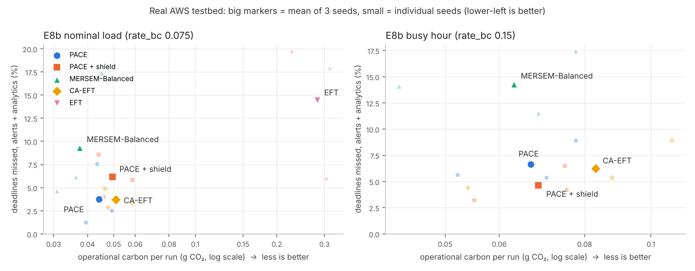

# PACE on the real AWS testbed (Coimbatore edge · Mumbai fog · Stockholm cloud)

Generated by `python -m experiments.testbed_report` from the run files in `results/testbed/`. Every run: 6 minutes of the test-split workload on 2 laptop edge workers + 4 EC2 instances; schedulers interleaved per seed so they share network conditions; PACE = `models/pace_live.pt` at w = 0.9; MERSEM-Balanced (w_s = 0.5, 120 s epochs). Background and failure analysis: `testbed/E8_ANALYSIS.md`; predictions written before the runs: `testbed/TWIN_PREDICTION.md`; sim-to-real: `testbed/E9_SIM2REAL.md`.

## E8b nominal load (rate_bc 0.075)

| Scheduler | runs | alerts missed % | analytics missed % | A+B missed % | per seed A+B % | carbon dyn (g) | p95 alert (s) | work edge/fog/cloud % |
|---|---|---|---|---|---|---|---|---|
| PACE | 3 | 1.4 | 30.2 | **3.8** | 7.6 / 1.2 / 2.5 | 0.0440 | 0.72 | 7/2/90 |
| PACE + shield | 3 | 4.2 | 29.0 | **6.1** | 4.0 / 8.6 / 5.9 | 0.0495 | 1.07 | 9/2/89 |
| MERSEM-Balanced | 3 | 6.1 | 45.9 | **9.4** | 17.3 / 6.1 / 4.6 | 0.0374 | 1.09 | 6/3/91 |
| CA-EFT | 3 | 0.8 | 37.0 | **3.7** | 4.9 / 2.9 / 3.3 | 0.0509 | 0.44 | 9/5/86 |
| EFT | 3 | 11.5 | 47.3 | **14.4** | 17.8 / 19.6 / 5.9 | 0.2819 | 1.98 | 28/58/14 |

## E8b busy hour (rate_bc 0.15)

| Scheduler | runs | alerts missed % | analytics missed % | A+B missed % | per seed A+B % | carbon dyn (g) | p95 alert (s) | work edge/fog/cloud % |
|---|---|---|---|---|---|---|---|---|
| PACE | 3 | 2.3 | 32.4 | **6.6** | 8.9 / 5.4 / 5.6 | 0.0667 | 0.77 | 4/3/93 |
| PACE + shield | 3 | 0.0 | 32.5 | **4.6** | 6.5 / 4.2 / 3.2 | 0.0685 | 0.50 | 5/3/93 |
| MERSEM-Balanced | 3 | 7.3 | 57.2 | **14.3** | 17.4 / 11.5 / 14.1 | 0.0630 | 1.11 | 2/5/93 |
| CA-EFT | 3 | 0.0 | 43.6 | **6.2** | 8.9 / 5.4 / 4.4 | 0.0830 | 0.36 | 4/8/88 |

## E8 nominal, static estimates

| Scheduler | runs | alerts missed % | analytics missed % | A+B missed % | per seed A+B % | carbon dyn (g) | p95 alert (s) | work edge/fog/cloud % |
|---|---|---|---|---|---|---|---|---|
| PACE | 3 | 13.9 | 23.7 | **14.7** | 3.1 / 19.2 / 21.8 | 0.0328 | 1.29 | 5/2/93 |
| PACE + shield | 3 | 9.9 | 34.4 | **11.8** | 3.6 / 10.6 / 21.3 | 0.0370 | 1.34 | 4/4/92 |
| MERSEM-Balanced | 3 | 6.9 | 49.2 | **10.3** | 10.2 / 9.8 / 10.9 | 0.0306 | 1.10 | 4/2/94 |
| CA-EFT | 3 | 21.6 | 34.6 | **22.7** | 4.0 / 35.1 / 28.9 | 0.0471 | 1.54 | 4/9/86 |
| EFT | 3 | 5.5 | 36.4 | **7.9** | 12.9 / 2.0 / 8.8 | 0.2303 | 1.41 | 15/63/22 |

EFT in E8b nominal ran in a separate session after an orchestrator fix (its first runs are in `testbed/invalid/`), so it is not interleaved with the other four.

## Paired comparison over the six E8b runs (3 nominal + 3 busy)

Δ = PACE variant minus baseline on the same seed and load (negative SLA Δ = PACE better). Wilcoxon signed-rank, two-sided; with 6 pairs the smallest attainable p is 0.031.

| PACE variant | vs | better in | Δ A+B missed (pp) | p | Δ carbon dyn | p |
|---|---|---|---|---|---|---|
| PACE | MERSEM-Balanced | 6/6 | -6.6 | 0.031 | +15% | 0.156 |
| PACE | CA-EFT | 2/6 | +0.2 | 0.875 | -15% | 0.031 |
| PACE + shield | MERSEM-Balanced | 4/6 | -6.4 | 0.156 | +25% | 0.094 |
| PACE + shield | CA-EFT | 4/6 | +0.4 | 1.000 | -9% | 0.156 |

## Reading

- **vs MERSEM (base paper):** PACE missed fewer deadlines in all six paired runs (−6.6 pp on average, p = 0.031), in both alerts and analytics, for +15 % operational carbon on average (not significant, p = 0.16). PACE + shield never missed an alert in the busy hour. At w = 0.9 PACE is configured to favour deadlines; MERSEM-Balanced sits at a lower-carbon, higher-miss point, so neither dominates on both axes in these runs.
- **vs CA-EFT (strongest heuristic):** the same deadline performance (+0.2 pp, p = 0.88) with 15 % less carbon (p = 0.031).
- **vs EFT:** EFT ignores carbon: 6× PACE's carbon at nominal load, and more missed deadlines.
- **E8 → E8b:** without the online network estimate the evening network drift to Mumbai made the latency-estimate-driven schedulers (PACE, CA-EFT) miss alerts; with it they recover. E8 and E8b ran at different times, so this comparison is indicative.
- **Limits:** 3 seeds per set, a campus network with four load-balanced uplinks, a lightly loaded testbed at nominal load (the carbon totals are small), and synthetic carbon-intensity profiles.
